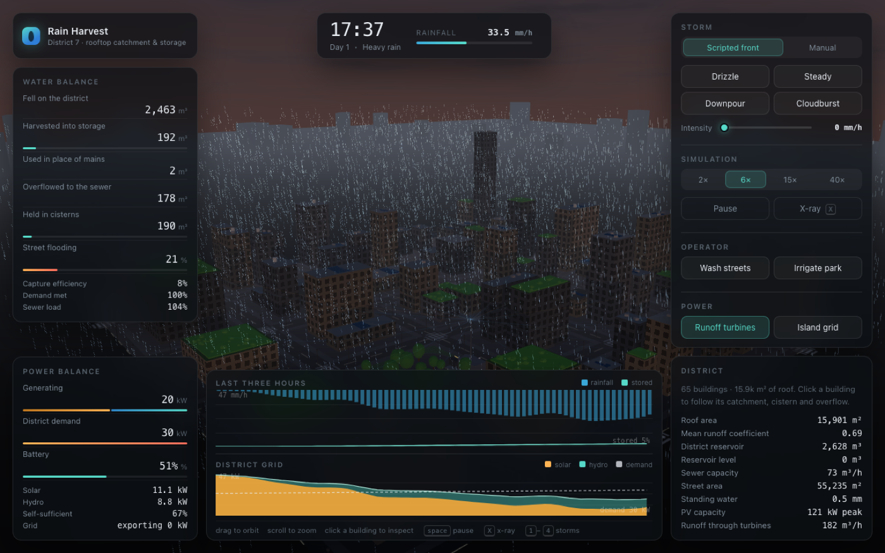

# Science Fest — Urban Rainwater Harvesting Simulation

An interactive Three.js simulation of urban rainwater harvesting: rooftop catchment, downspouts,
cisterns, district storage, sewer surcharge and street flooding — plus on-site electricity
generation (solar and micro-hydro) and the power balance of the district grid.



## Run

```bash
npm install
npm run dev      # http://localhost:5173
npm run build    # typecheck + production build
```

## The model

Rain falls on a 65-building district of about 16k m² of roof.

```
rainfall → roof catchment → downspout → building cistern → district main
        → district reservoir → demand (mains substitution, irrigation,
           street washing) → municipal sewer → street flooding
```

- Roof runoff depends on the surface: green roof 0.28, concrete 0.83, ballast 0.89, metal 0.95.
- Each building owns a cistern; anything it cannot keep travels on the district main to the
  shared reservoir, and anything the network cannot take goes down the sewer.
- The sewer has a finite capacity. Past it, water ponds in the street network and the
  ground wets, ponds and floods.
- The same water turns the district's downspout turbines and the runoff turbine house, while
  rooftop PV covers the daytime load and a battery covers the night.

## Controls

- drag to orbit, scroll to zoom
- click a building to follow its catchment, cistern, overflow and net power
- `1`–`4` storm presets, `space` pause, `X` x-ray (see the cisterns and pipework underground)

## Layout

- `src/sim/` — simulation core: hydrology, storm, city layout, clock, power, logging
- `src/scene/` — Three.js scene: buildings, ground, rain, splashes, sky, network, power
- `src/ui/` — HUD, charts, power chart
- `src/core/rng.ts` — deterministic seeded RNG
- `scripts/sim-check.ts` — headless run of the simulation core, no browser needed

Built with Vite + TypeScript + Three.js.
